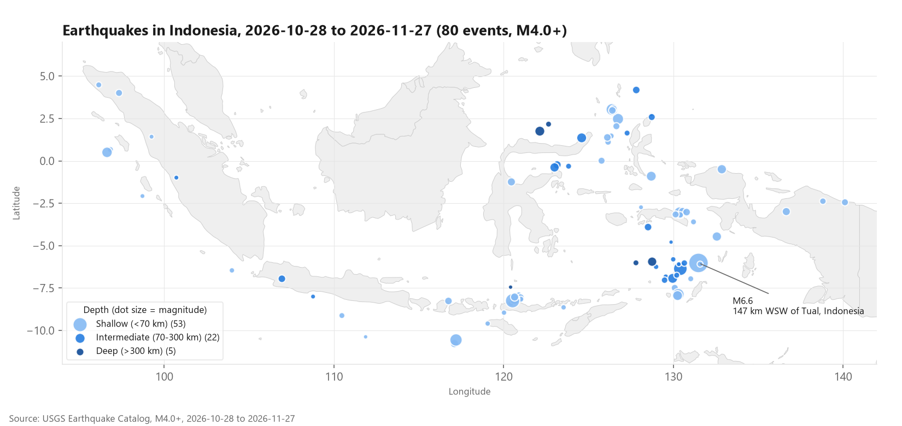
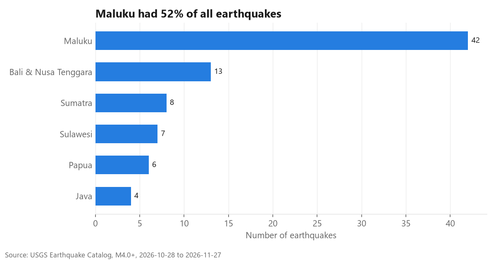
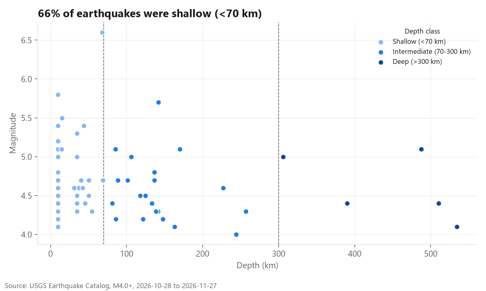
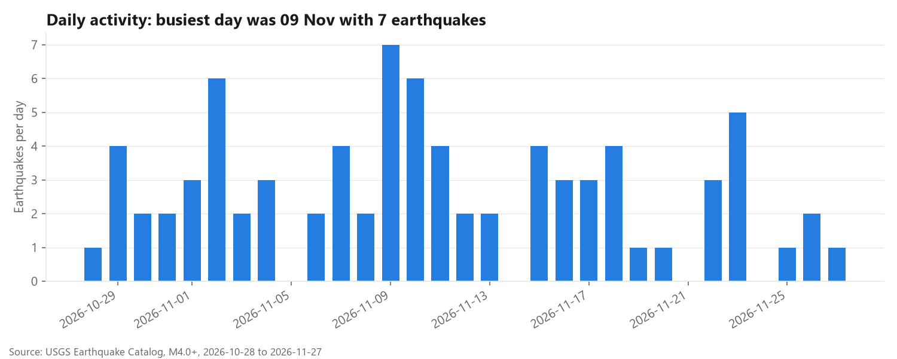

# Indonesia Earthquake Data Pipeline

An automated Python pipeline that downloads earthquake data for Indonesia every day, cleans it, and produces analysis-ready data, charts, and a summary report.



## What it does

| Step | Script | Output |
|---|---|---|
| 1. Fetch | `src/fetch.py` | Downloads the last 30 days of M4.0+ earthquakes from the USGS Earthquake API and saves the untouched file to `data/raw/` |
| 2. Clean | `src/clean.py` | Keeps only events in Indonesia, renames columns, converts UTC to local time (WIB), classifies depth, and assigns an island region |
| 3. Analyze | `src/analyze.py` | Builds 4 charts and a text summary in `outputs/` |
| 4. Automate | `src/pipeline.py` + `run_pipeline.bat` | Runs all steps in order with logging and automatic retries; scheduled daily with Windows Task Scheduler |

## Key findings (snapshot: 28 Oct – 27 Nov 2026)

- **80 earthquakes of magnitude 4.0+** were recorded in Indonesia; 35 events from neighboring countries (Philippines, Timor-Leste, Palau) were removed during cleaning.
- **Maluku accounted for 52%** of all events, far more than any other region.
- **66% were shallow (<70 km)**, the depth range most likely to cause damage at the surface.
- The largest event was **M6.6, 147 km WSW of Tual (Maluku)** on 17 Nov 2026.

| Earthquakes by region | Magnitude vs. depth |
|---|---|
|  |  |



## How to run

Requires Python 3.11 or newer.

```bash
python -m venv .venv
.venv\Scripts\activate          # Windows (macOS/Linux: source .venv/bin/activate)
pip install -r requirements.txt

python src/pipeline.py          # run the full pipeline
```

Each step can also run on its own, for example `python src/fetch.py 7 3.5` downloads the last 7 days with magnitude 3.5 and above.

To run it automatically every day on Windows, point Task Scheduler at `run_pipeline.bat`. Every run is logged to `logs/pipeline.log`.

## Project structure

```
earthquake-pipeline/
├── src/
│   ├── fetch.py        # 1. download from the USGS API
│   ├── clean.py        # 2. filter, rename, convert time, classify
│   ├── analyze.py      # 3. charts and summary
│   └── pipeline.py     # 4. runs all steps with logging and retries
├── outputs/
│   ├── figures/        # charts (PNG)
│   └── summary.txt     # key numbers
├── run_pipeline.bat    # launcher for Windows Task Scheduler
└── requirements.txt
```

`data/` and `logs/` are created when the pipeline runs and are not stored in the repository.

## Data notes and limitations

- **Source:** [USGS Earthquake Catalog](https://earthquake.usgs.gov/fdsnws/event/1/) (public, no API key needed). Country borders: [Natural Earth](https://www.naturalearthdata.com/) (public domain), downloaded automatically on first run.
- **Fixed 10 km depth:** many shallow events sit at exactly 10 km. USGS uses 10 km as a default when the true depth cannot be resolved, so these mean "shallow, exact depth unknown".
- **Regions are approximate:** island regions are assigned from simple latitude/longitude boxes, so events near region borders (for example, the Makassar Strait) may be grouped with a neighboring region.
- **Magnitude threshold:** the pipeline uses M4.0+, the level USGS reports consistently for this region. Smaller events recorded by Indonesia's BMKG are not included.

## Skills demonstrated

Python, pandas, REST API data collection, data cleaning and validation, geospatial data (GeoPandas), data visualization (Matplotlib), workflow automation and scheduling, logging and error handling.

## Author

**Adira Danuarta**, Geophysics graduate (Universitas Gadjah Mada), data analyst.
[LinkedIn](https://www.linkedin.com/in/adira-danuarta)
